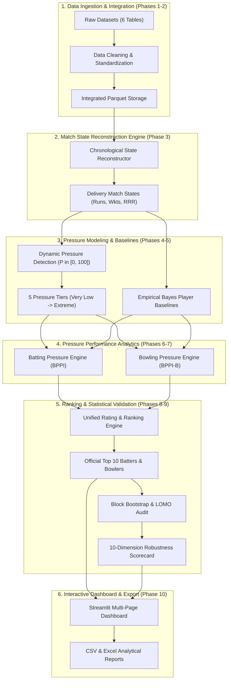

# PressureIQ — System Architecture & Data Flow Design

**System:** PressureIQ: AI-Powered Cricket Pressure Performance Analytics  
**Document:** System Architecture Technical Specification  
**Version:** 1.0.0  
**Target Submission:** SupeRR Selector Season 2 — Round 1

---

## 1. High-Level Architectural Overview

PressureIQ is architected as an end-to-end, multi-stage analytical platform designed to decouple data ingestion, match-state reconstruction, statistical baseline estimation, pressure modeling, ranking, and UI visualization.

---

## 2. Core Subsystems & Modular Layering

### 2.1 Ingestion & Data Hygiene (`src/preprocessing.py`, `src/data_loader.py`)
- Standardizes raw datasets: `competitions.csv`, `teams.csv`, `matches.csv`, `playing_eleven.csv`, `competition_team_player_mapping.csv`, `ball_by_ball.csv`.
- Deduplicates composite keys `(match_id, innings, overid, over_ball_num)`.
- Eliminates orphaned delivery records and standardizes player entity identifiers.
- Writes partitioned Parquet files to `data/processed/` with snappy compression.

### 2.2 Match State Reconstruction Engine (`src/match_state/`)
- Reconstructs chronological match conditions immediately prior to and after each ball.
- Evaluates legal delivery sequences ($\mathcal{L}(d)$), innings phase boundaries (Powerplay overs 1–6, Middle overs 7–15, Death overs 16–20), balls remaining, runs required, and target scores.
- Restricts Required Run Rate ($RRR$) to second-innings run-chases, isolating first innings scoring to historical stadium par baselines.

### 2.3 Pressure Detection Engine (`src/pressure/`)
- Implements the multi-factor pressure index ($P \in [0, 100]$) at ball-level resolution.
- Separates batting leverage ($RRR$, wickets lost, balls remaining, match closeness, knockout status) from defensive bowling leverage (target protection, death over hazards, boundary containment).
- Flags high-pressure deliveries ($\mathcal{H}(d) = 1$ when $P(d) \ge 60.0$) and extreme-pressure deliveries ($P(d) \ge 80.0$).

### 2.4 Baseline Calculation Engine (`src/baselines/`)
- Computes career non-pressure benchmarks for eligible batters and bowlers post-2022.
- Applies Empirical Bayes shrinkage ($B_i$) to regress small-sample raw strike rates, batting averages, and economy rates toward tournament cohort priors.

### 2.5 Pressure Performance Analytics (`src/batting_pressure/`, `src/bowling_pressure/`)
- Measures performance retention: Strike Rate Retention ($Ret_{\text{SR}}$), Economy Retention ($Ret_{\text{Econ}}$), and Dot Ball Control.
- Computes composite resilience indices: Batter Pressure Performance Index ($BPPI$) and Bowler Pressure Performance Index ($BPPI\text{-}B$).

### 2.6 Unified Rating & Ranking Engine (`src/ranking/`)
- Synthesizes 4 core pillars: Resilience ($35\%$), Absolute Execution ($30\%$), Consistency ($20\%$), and Context/Role Leverage ($15\%$).
- Computes shrinkage-adjusted ratings: Final Batter Pressure Rating ($FBPR$) and Final Bowler Pressure Rating ($FBOR$).
- Establishes Bayesian standard errors ($SE_i$) and $95\%$ confidence intervals ($CI_{95}$).

### 2.7 Statistical Validation Engine (`src/validation/`)
- Match-level block bootstrap ($B = 100$) preserving intra-game bowler-batter co-dependence.
- Leave-One-Match-Out (LOMO) jackknife stability measuring maximum single-match rank drops.
- Sensitivity scans across 6 alternative weight profiles and $\pm 50\%$ eligibility exposure thresholds.
- Exhaustive 12-check data leakage audit.

### 2.8 Interactive Streamlit Dashboard (`dashboard/`)
- Multi-page application with 9 analytical views (`Overview`, `Batter Rankings`, `Bowler Rankings`, `Player Analysis`, `Player Comparison`, `Pressure Analysis`, `Statistical Validation`, `Methodology`, `Data Quality`).
- DuckDB-accelerated aggregations across 200,999 delivery rows.
- Interactive Plotly visualizations and CSV/Excel download capabilities.

---

## 3. Technology Stack Specification

| Subsystem | Technology / Library | Version | Operational Functionality |
| :--- | :--- | :---: | :--- |
| **Language Runtime** | Python | 3.14 / 3.11+ | Core runtime environment |
| **Data Processing** | Pandas | 2.2+ | Dataframe manipulation and indexing |
| **Numerical Computations** | NumPy | 2.0+ | Vectorized linear scaling and shrinkage |
| **Columnar Storage & Query**| PyArrow & DuckDB | 15.0+ / 1.0+ | Fast Parquet I/O and SQL delivery aggregation |
| **Scientific Statistics** | SciPy & Statsmodels | 1.13+ / 0.14+ | Bootstrap distribution fitting and inference |
| **Visual Analytics** | Plotly & Matplotlib | 5.20+ / 3.8+ | Interactive dashboard and 300 DPI publication charts |
| **UI Dashboard** | Streamlit | 1.67+ | Responsive multi-page analytical dashboard |
| **Document Generation** | ReportLab & python-docx| 4.0+ / 1.2+ | Automated PDF and DOCX report generation |
| **Automated Testing** | Pytest & pytest-cov | 8.0+ / 5.0+ | 183 automated unit and integration tests |

